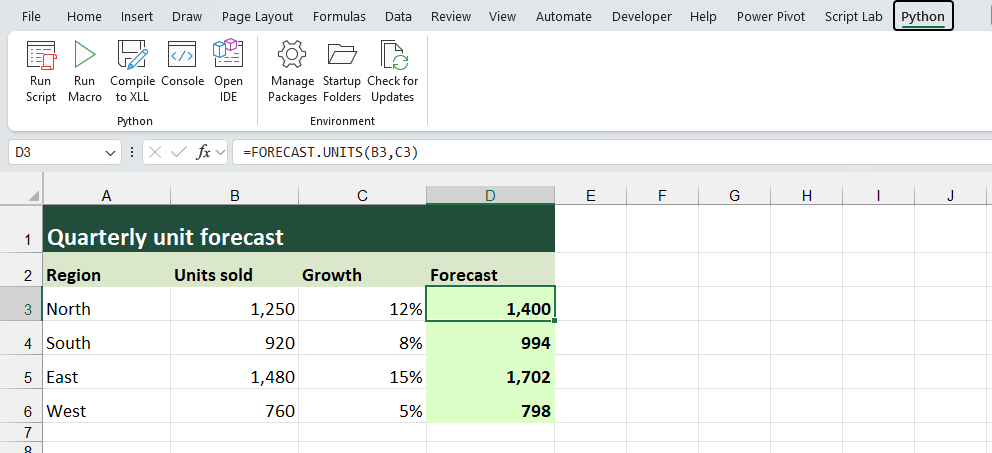
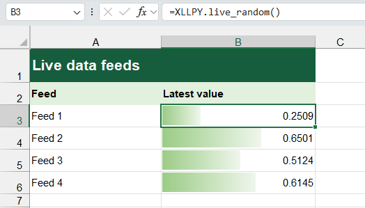
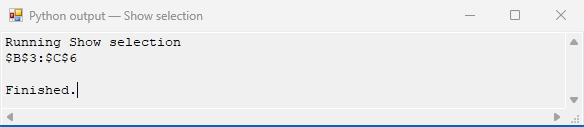
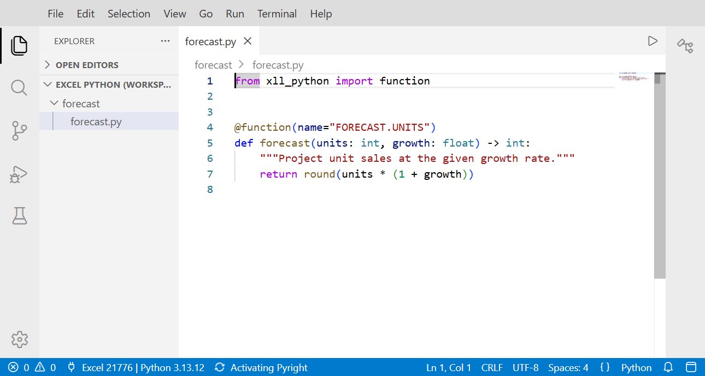
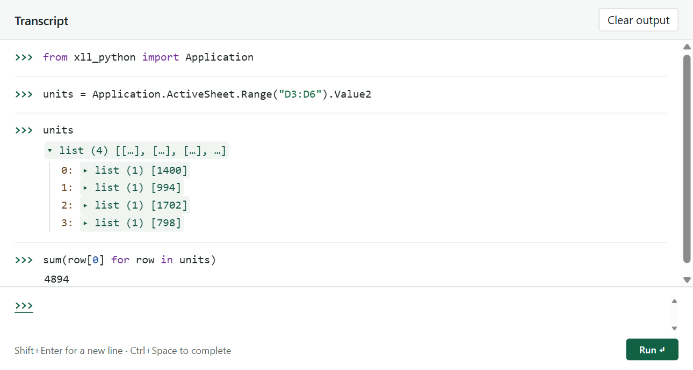
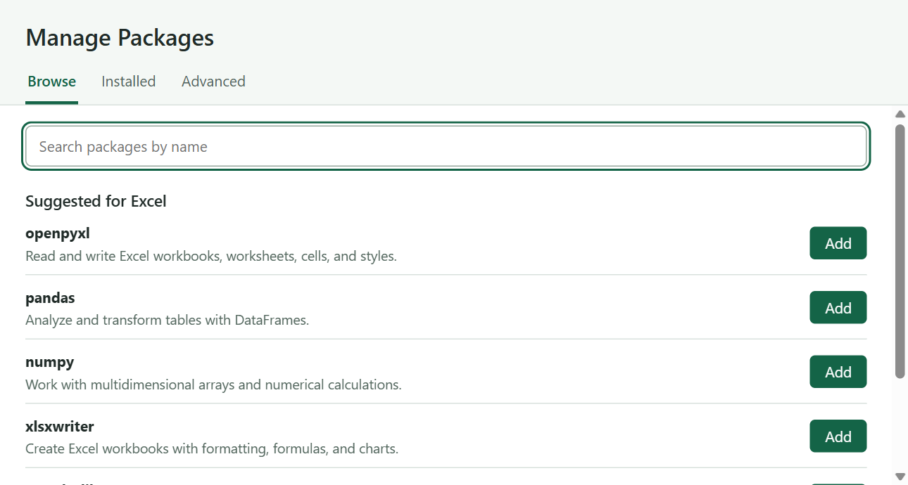
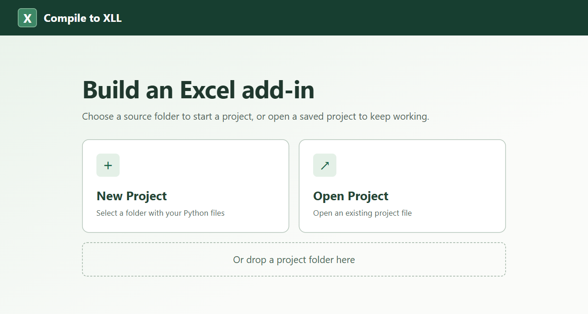

# Python for desktop Excel

XLL Python is a free add-in for **64-bit Excel on Windows**. Write a Python function, call it from a cell, and debug it in the bundled editor. CPython 3.13 and its standard library come in the XLL, so the forecast below runs offline.

[Download the Windows x64 add-in](https://github.com/sancarn/xll-python/releases/latest/download/xll-python.xll) · [Installation guide with screenshots](https://sancarn.github.io/xll-python/install.html) · [Feature tour](https://sancarn.github.io/xll-python/#tour) · [Technical reference](docs/reference.md)



## Load the add-in

1. Save `xll-python.xll` in a permanent local folder. The release is unsigned. If Windows blocks the file, review its source and your organisation’s policy before using **Properties → Unblock**.
2. In Excel, open **File → Options → Add-ins**. Under **Manage**, choose **Excel Add-ins → Go → Browse**, select the XLL, and leave it checked.
3. Look for the **Python** ribbon tab. The add-in extracts its interpreter on first use and reuses it in later sessions.

Use the ribbon to [manage Python packages](#manage-packages), [run a script](docs/reference.md#run-a-script), or [update the add-in](docs/reference.md#update-the-add-in).

## Worksheet functions

Try the forecast shown above with [forecast.py](https://sancarn.github.io/xll-python/assets/forecast.py) and the [starter workbook](https://sancarn.github.io/xll-python/assets/Forecast.xlsx). The decorator gives this function its Excel formula name.

```python
from xll_python import function

@function(name="FORECAST.UNITS")
def forecast(units: int, growth: float) -> int:
    return round(units * (1 + growth))
```

1. Save `forecast.py` in a folder you trust. In **Python → Startup Folders → Worksheet functions**, add that folder and choose **Refresh**.
2. Open `Forecast.xlsx`. In **D3**, enter `=FORECAST.UNITS(B3,C3)`. You should see **1,400**.
3. Fill the formula down to **D6** to forecast sales for the other regions.

[Function options, async calculations, and range handling](docs/reference.md#worksheet-functions)

### Live data feeds

A Python generator can update a cell with each `yield`. Load the [example functions](examples/functions.py) the same way, then enter `=XLLPY.live_random()` and fill it down. Each cell gets its own random number every two seconds.



[Watch the cells update](docs/assets/live-data.gif)

## Automate Excel from Python

Save this macro in a worksheet startup folder and choose **Refresh**. Select some cells, open **Python → Run Macro**, choose **Show selection**, and click **Run**.

```python
from xll_python import Application, macro

@macro(name="Show selection")
def show_selection():
    print(Application.Selection.Address)
```



[Macro registration and reading or writing ranges](docs/reference.md#automate-excel-from-python)

## Call Python from VBA

Use `Application.COMAddIns("XllPython.Automation").Object` to call a registered Python function from VBA. With the example functions loaded, `py.CallFunction("XLLPY.scale", Array(21))` returns **42** when `py` holds that object.

[VBA examples for functions, macro jobs, and live subscriptions](docs/reference.md#call-python-from-vba)

## Excel Python IDE

Choose **Python → Open IDE** and edit `forecast.py`. Saving the file reloads the function and recalculates your workbook. To step through the formula, set a breakpoint, run **Excel: Debug Worksheet Functions** from the command palette, and recalculate the cell.



[Running scripts and debugging worksheet functions](docs/reference.md#excel-python-ide)

## Python console

Open **Python → Console** and read the forecast back from the active sheet. After filling D3:D6, the four regions total **4,894** units.

```python
from xll_python import Application

rows = Application.ActiveSheet.Range("D3:D6").Value2
sum(row[0] for row in rows)
```



[Inspecting objects and trying console functions in a cell](docs/reference.md#python-console)

## Manage packages

In **Python → Manage Packages**, search PyPI and choose **Add** to install a package for Excel. **Installed** shows versions and dependencies. **Advanced** accepts pip commands and local wheels.



[Package installs, command logs, and offline use](docs/reference.md#manage-packages)

## Compile your own XLL

Open **Python → Compile to XLL → New Project** and choose your source folder. Mark `forecast.py` as an **Entry module**, select any packages you need, then choose **Compile XLL**. A colleague with 64-bit Excel on Windows can load the resulting file and use the formula offline.



[Bundling packages, adding ribbon buttons, and building a smaller XLL](docs/reference.md#compile-your-own-xll)

## Build and verify

[Build the workbench from source and run its Excel smoke tests](docs/reference.md#build-and-verify).

## Licence

XLL Python is source-available and free for business use. Redistribute the framework free of charge with its matching source and build scripts. You can sell add-ins that provide your own functionality under the package exception. [Framework licence](LICENSE) · [Permission for independent add-ins](LICENSE-PACKAGE-EXCEPTIONS.txt)

The example functions and README code snippets are available under [0BSD](examples/LICENSE). Bundled components keep their own licences. [Third-party notices](notices/Third-party-sources.md)
